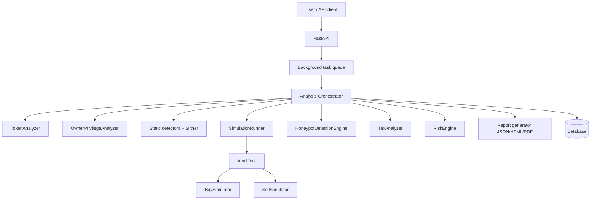
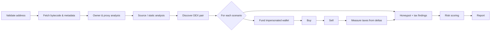

# Blockchain Honeypot Detection & Token Security Analyzer

### 🔗 Live dashboard: <https://imrankhansaami.github.io/Blockchain-Honeypot-Detection/>

[](https://github.com/imrankhansaami/Blockchain-Honeypot-Detection/actions/workflows/ci.yml)
[](https://github.com/imrankhansaami/Blockchain-Honeypot-Detection/actions/workflows/deploy-pages.yml)
[](https://imrankhansaami.github.io/Blockchain-Honeypot-Detection/)

The dashboard UI is hosted on GitHub Pages. It becomes fully functional once
`NEXT_PUBLIC_API_BASE` (a GitHub Actions *repository variable*) points at a
deployed backend — see [`render.yaml`](render.yaml) for a one-click Render
deploy, and [Live deployment](#live-deployment) below.

An automated security-research tool that analyses ERC-20 tokens for honeypot
behaviour, dangerous owner privileges, transfer restrictions and excessive taxes.
It performs **real on-chain analysis and real buy/sell simulation on disposable
local forks** — it is not a static prototype and does not consult a hand-written
scam list.

> **Disclaimer.** This tool produces automated analysis and simulation results.
> It is **not** a formal smart-contract audit and gives **no guarantee** of token
> safety. A low risk score does not mean a token is safe.

---

## Table of contents

- [Problem statement](#problem-statement)
- [Key features](#key-features)
- [Architecture](#architecture)
- [Analysis workflow](#analysis-workflow)
- [Technology stack](#technology-stack)
- [Repository layout](#repository-layout)
- [Installation](#installation)
- [Configuration](#configuration)
- [Usage](#usage)
- [API documentation](#api-documentation)
- [Live deployment](#live-deployment)
- [Example analysis](#example-analysis)
- [Testing](#testing)
- [Security methodology](#security-methodology)
- [Known limitations](#known-limitations)
- [Roadmap](#roadmap)

---

## Problem statement

Token buyers routinely lose funds to "honeypot" tokens that accept purchases but
block selling, to hidden owner privileges (unlimited minting, blacklists, 100%
sell taxes, upgradeable logic), and to restrictions that only trigger after a
wallet has bought. Static "token info" dashboards and name-based scam lists do
not catch these. Detecting them requires inspecting the contract, its privileges
and **actually attempting to buy and sell in a sandbox**.

This project builds that capability end to end: a Python/FastAPI analysis engine,
a Foundry + Anvil simulation layer, and a Next.js security dashboard.

## Key features

- **Live contract analysis** — bytecode, metadata, owner, EIP-1967 proxy storage
  slots, verified-source retrieval, DEX pair discovery.
- **Owner privilege analysis** — minting, pause, blacklist/whitelist, tax control,
  trading gates, upgrade authority, asset withdrawal — each with the abuse
  scenario and evidence.
- **Real buy/sell simulation** — disposable Anvil forks execute genuine swaps
  through Uniswap-V2-compatible routers (including the fee-on-transfer entry
  points), from funded, impersonated wallets. No real funds, no private keys.
- **Tax measurement** — effective buy/sell tax computed from balance deltas,
  never from gas.
- **Custom static detectors** — block/time restrictions, blacklists, delegatecall,
  unrestricted admin functions, mint logic — with optional Slither integration.
- **A deep Solidity suite** — beyond the 27 analyzer target fixtures, the repo
  ships a full Uniswap V2 reference implementation (core + router + libraries),
  the mock DEX, DeFi primitives (ERC-4626 vault, staking, lending pool, flash
  loans, escrow, auctions, oracles), extra token standards (ERC-721, ERC-1155,
  ERC-1363, ERC-3156 flash-mint, soulbound, dividends, rebase), periphery
  (buyback, liquid locker, vesting, timelock vault, multisig, fee splitter) and
  an on-chain honeypot-pattern taxonomy — 95 Solidity files.
- **Explainable risk scoring** — 0–100 score, de-duplicated by category, weighted
  by evidence strength and confidence, with a written explanation.
- **Structured findings** — severity + confidence (`confirmed` / `suspicious` /
  `inconclusive`) + evidence source (`simulation` / `onchain` / `source_code` /
  `abi` / `bytecode` / `heuristic`).
- **Reports** — JSON, HTML and PDF.
- **REST API + background jobs + PostgreSQL/SQLite persistence**.
- **Security dashboard** — dark, responsive, technical.

## Architecture



The analysis engine is deliberately decomposed: each component emits structured
findings and can be tested and reasoned about independently.

## Analysis workflow



## Technology stack

| Layer | Technology |
| --- | --- |
| Contracts & simulation | Solidity 0.8.28, Foundry, Anvil, Uniswap-V2-compatible mocks |
| Backend | Python 3.12, FastAPI, Pydantic v2, Web3.py, SQLAlchemy, Celery (optional) |
| Database | PostgreSQL (SQLite for zero-setup dev) |
| Static analysis | Custom detectors, Slither (optional) |
| Frontend | Next.js 14, React 18, TypeScript (strict), Tailwind CSS, Recharts |
| Reports | Jinja2 (HTML), ReportLab (PDF) |
| Testing | Forge (unit/fuzz/invariant/adversarial), Pytest, Hypothesis |

Wallet connectivity (Wagmi/Viem) is intentionally omitted: this tool performs
read-only analysis and never requests a user's wallet, keys or seed phrase.

## Repository layout

```
blockchain-honeypot-detector/
├── backend/          FastAPI app, analyzers, simulations, reports, tests
├── contracts/        Foundry project: mock DEX + 13 token fixtures + tests
├── frontend/         Next.js security dashboard
├── docs/             architecture, threat model, methodology, scoring, limits
├── scripts/          developer helpers
├── .github/workflows CI pipeline
├── docker-compose.yml
└── README.md
```

## Installation

### Prerequisites

- Python 3.12+
- Node.js 20+
- [Foundry](https://book.getfoundry.sh/) (`forge`, `anvil`) — required for simulation

### Backend

```bash
python -m venv .venv
# Windows: .venv\Scripts\activate     Linux/macOS: source .venv/bin/activate
pip install -r backend/requirements.txt
cp .env.example .env   # then fill in RPC URLs and explorer keys
```

Run the API (from `backend/`):

```bash
uvicorn app.main:app --reload
```

Database schema is created automatically on startup for development. For managed
migrations use Alembic from `backend/`:

```bash
alembic revision --autogenerate -m "init"
alembic upgrade head
```

### Contracts

```bash
git submodule update --init --recursive
cd contracts
forge build
forge test          # 84 tests: unit, fuzz, invariant, adversarial, AMM, DeFi
```

### Frontend

```bash
cd frontend
npm install
NEXT_PUBLIC_API_BASE=http://localhost:8000 npm run dev
```

### Docker

```bash
docker compose up --build
```

## Configuration

All configuration is environment-driven; nothing is hardcoded. See
`.env.example`. Key variables:

| Variable | Purpose |
| --- | --- |
| `MAINNET_RPC_URL`, `SEPOLIA_RPC_URL`, `BSC_RPC_URL`, `BSC_TESTNET_RPC_URL` | Per-chain RPC endpoints (blank ⇒ chain unavailable) |
| `ETHERSCAN_API_KEY`, `BSCSCAN_API_KEY` | Explorer verification + source retrieval |
| `RPC_ALLOWED_HOSTS` | Optional SSRF allow-list for RPC hosts |
| `DATABASE_URL` | `sqlite+pysqlite:///./data/honeypot.db` or a PostgreSQL URL |
| `SIMULATION_ENABLED`, `ANVIL_BINARY` | Anvil simulation toggle and binary |
| `SLITHER_ENABLED`, `SLITHER_BINARY` | Optional Slither static analysis |

**Never** put a private key or seed phrase in the configuration — the tool does
not need one.

## Usage

### Analyze a token

```bash
curl -X POST http://localhost:8000/api/v1/analyze \
  -H "Content-Type: application/json" \
  -d '{"chain_id":1,"token_address":"0x…","analysis_depth":"standard"}'
```

Poll the result:

```bash
curl http://localhost:8000/api/v1/analyze/<analysis_id>
```

Download a PDF report:

```bash
curl -L "http://localhost:8000/api/v1/reports/<analysis_id>/download?format=pdf" -o report.pdf
```

## API documentation

| Method | Path | Description |
| --- | --- | --- |
| `POST` | `/api/v1/analyze` | Start a full analysis (202 Accepted) |
| `GET` | `/api/v1/analyze/{analysis_id}` | Status and results |
| `GET` | `/api/v1/analyses` | Recent analyses |
| `GET` | `/api/v1/token/{chain_id}/{address}` | Token information only |
| `POST` | `/api/v1/simulate/buy` | Single buy simulation on a fresh fork |
| `POST` | `/api/v1/simulate/sell` | Single buy→sell simulation on a fresh fork |
| `GET` | `/api/v1/reports/{analysis_id}` | JSON report |
| `GET` | `/api/v1/reports/{analysis_id}/download?format=json\|html\|pdf` | Download |
| `GET` | `/api/v1/health` | Health + chain status |
| `GET` | `/api/v1/chains` | Chain registry |

Interactive docs are served at `/docs`.

## Example analysis

```json
{
  "analysis_id": "9f3c…",
  "chain_id": 1,
  "token_address": "0x…",
  "status": "completed",
  "block_number": 21700000,
  "risk": {
    "score": 62,
    "classification": "High risk",
    "explanation": [
      "+60 pts [critical/confirmed/simulation] Token can be bought but cannot be sold",
      "+20 pts [high/suspicious/bytecode] Arbitrary minting capability",
      "Findings are de-duplicated by category; the strongest finding per category is scored."
    ],
    "uncertainties": ["Contract source is not verified on the explorer…"],
    "disclaimer": "This report represents automated security analysis and simulation results. It is not a formal smart contract audit or a guarantee of token safety."
  },
  "findings": [
    {
      "id": "honeypot.cannot_sell",
      "title": "Token can be bought but cannot be sold",
      "severity": "critical",
      "confidence": "confirmed",
      "source": "simulation",
      "evidence": { "fork_block": 21700000, "sell_revert": "Sell not allowed" }
    }
  ]
}
```

## Live deployment

### Dashboard (GitHub Pages)

The dashboard is a statically-exported Next.js app deployed to GitHub Pages by
[`.github/workflows/deploy-pages.yml`](.github/workflows/deploy-pages.yml):

**https://imrankhansaami.github.io/Blockchain-Honeypot-Detection/**

The UI is fully live. To make its pages show real data, deploy the backend and
point the dashboard at it.

### Backend (Render blueprint)

[`render.yaml`](render.yaml) deploys the Dockerised FastAPI backend plus a
managed PostgreSQL database on Render's free tier:

1. In Render: **New → Blueprint**, connect this repository, apply.
2. Set `MAINNET_RPC_URL` / `BSC_RPC_URL` / `ETHERSCAN_API_KEY` in the service's
   environment (they are marked `sync: false`, so they are never committed).
3. Copy the backend URL, then in GitHub: **Settings → Secrets and variables →
   Actions → Variables → New variable** named `NEXT_PUBLIC_API_BASE` with that
   URL.
4. Re-run **Deploy dashboard to GitHub Pages** (or push to `main`).

> Free instances are small; set `SIMULATION_ENABLED=false` for fast static-only
> analyses. Anvil fork simulation needs an archive-capable RPC.

### Docker (self-host)

`docker compose up --build` runs the full stack locally (Postgres + backend +
frontend).

## Testing

```bash
# Contracts (unit, fuzz, invariant, adversarial)
cd contracts && forge test

# Backend (unit + integration; includes a hermetic Anvil buy/sell simulation)
cd backend && pytest

# Frontend
cd frontend && npm run typecheck && npm run build
```

The backend simulation tests deploy the Foundry fixtures to a bare Anvil and run
real buys/sells against the mock DEX — no external RPC required.

## Security methodology

- Only the configured RPC endpoints are contacted; RPC URLs are SSRF-validated
  and can be restricted to an allow-list.
- Simulations run in isolated Anvil processes bound to localhost, funded and
  impersonated via `anvil_*` RPC; **no private keys are used and no transaction
  is ever sent to a real network**.
- Findings distinguish confirmed behaviour from suspicion and inconclusiveness,
  and every finding carries its evidence source.
- The risk engine de-duplicates correlated findings and weights reproducible
  behavioural evidence above naming heuristics.

See `docs/` for the full threat model, detection methodology, scoring and limits.

## Known limitations

- Uniswap-V2-compatible routers only (no V3/non-standard routers yet).
- Fork simulation requires an archive-capable RPC for historical blocks.
- Behaviour can differ at other blocks or for other wallets; simulations use
  fresh on-fork wallets.
- Unverified contracts can only be analysed at the ABI/bytecode level.
- Results are indicative, not a substitute for a manual audit.

## Roadmap

- Uniswap V3 / algebra route support.
- Richer bytecode decompilation heuristics.
- Multi-block and multi-wallet adversarial scenario matrices.
- Persistent finding deduplication across historical scans.
- Tenderly-style transaction tracing integration.
- Time-series token reputation tracking.

## Screenshots and demo

The dashboard is a dark security console with an overview, a token analyzer form,
a results view (risk gauge, owner privileges, simulation table, filterable
findings) and a report center. To view it locally:

```bash
# terminal 1
cd backend && uvicorn app.main:app --reload
# terminal 2
cd frontend && NEXT_PUBLIC_API_BASE=http://localhost:8000 npm run dev
```

Open http://localhost:3000.

To record a short demo: run the analyzer against a token, then show the
simulation tab (buy succeeds / sell reverts) and download the PDF report. An
example generated report is committed at `docs/examples/example-honeypot.{json,html,pdf}`.

## License

Provided for security research and educational use. See [LICENSE](LICENSE).
